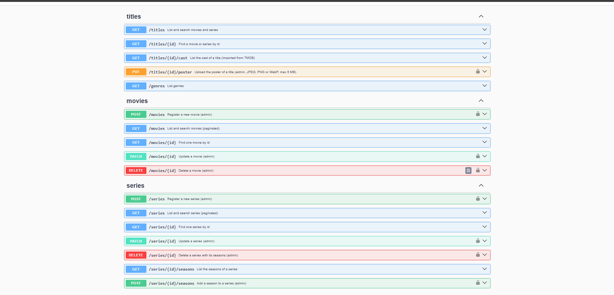
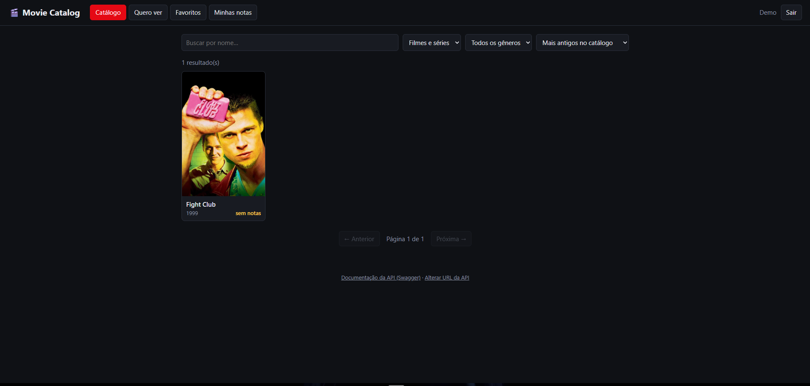
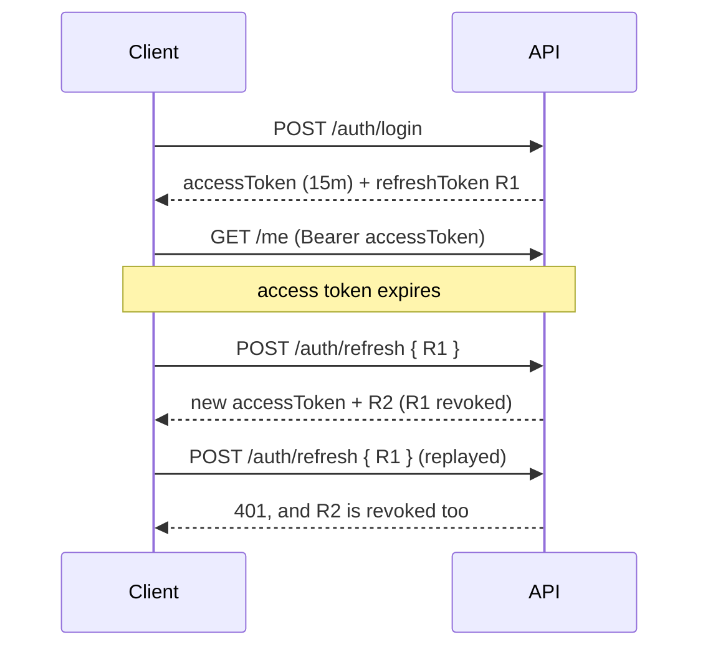
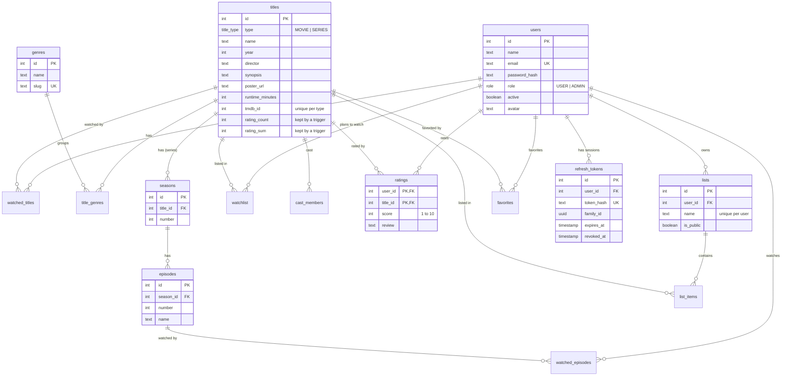
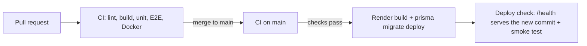

# Movie Catalog API

A REST API for a movie and series catalog: browse and search titles, rate and review them, and keep personal lists (watched, favorites, watchlist, custom lists), with stats and recommendations based on your taste.

Built with **NestJS**, **TypeScript**, **Prisma** and **PostgreSQL**, and deployed on Render with continuous deployment gated by CI.

## Live demo

| | |
| --- | --- |
| Web front end | https://movie-catalog-eosin-gamma.vercel.app ([repository](https://github.com/brunocmg/movie-catalog-web)) |
| API docs (Swagger) | https://movie-catalog-api-54m7.onrender.com/docs |

> **Note:** the API runs on Render's free plan and goes to sleep when idle. The first request can take about a minute to wake it up.

To try the web app without signing up, click **Testar com conta demo**. It is a regular `USER` account, so it cannot change the catalog.

## Screenshots

API docs (Swagger):



A simple web front end ([repository](https://github.com/brunocmg/movie-catalog-web)) built only to try the API:



## Features

- **Catalog:** movies and series share one model (runtime, synopsis, poster, genres). Search by name, filter by type, genre and year, sort and paginate. Writes are restricted to admins.
- **Series:** seasons and episodes, with per-episode watch tracking. A series counts as watched when its episodes are.
- **Personal lists:** watch history, favorites, a watchlist with priority, and custom lists (public or private).
- **Ratings and reviews:** one score from 1 to 10 per user and title, with an optional review. The average is kept by a database trigger.
- **Stats and recommendations:** totals, watch time and top genres per user. Unwatched titles are ranked by your taste and community ratings, and each result says which genres matched.
- **TMDB import:** an admin imports a movie or series with poster, genres, director, cast and, for series, seasons and episodes.
- **Authentication:** JWT access tokens (15 min) and opaque refresh tokens with rotation, reuse detection and logout. Passwords are hashed with bcrypt.
- **Authorization:** `USER` and `ADMIN` roles, loaded from the database on every request, so a role change or deactivation applies immediately.
- **Security:** helmet, configurable CORS, rate limiting (stricter on login and sign-up), generic login errors and constant-time comparison against user enumeration.
- **Images:** avatars and posters on Cloudinary in production and on local disk in development (JPEG, PNG or WebP, checked by file signature).
- **Cache:** Redis for title listings and details, with an in-memory fallback. Writes invalidate it, and a Redis outage never blocks the API.
- **Observability:** structured JSON logs (pino) with a request id echoed in `X-Request-Id` and in error bodies, Prometheus metrics at `/metrics`, and a health check with a database probe.
- **Quality:** DTO validation, a consistent error format, environment validated at boot, unit and E2E tests, and a multi-stage Docker image.

## Main endpoints

The full list, with request and response schemas, is in Swagger at `/docs`.

| Area | Endpoints |
| --- | --- |
| Auth | `POST /auth/login`, `/auth/refresh`, `/auth/logout`, `/auth/logout-all` |
| Catalog | `GET /titles`, `/titles/:id`, `/titles/:id/cast`, `/titles/:id/reviews`, `/genres`, `/movies`, `/series` |
| Series | `GET /series/:id/seasons`, `/seasons/:id/episodes`, `/episodes/:id` |
| Account | `POST /users`, `GET` and `PATCH /me`, `POST /users/upload` (avatar) |
| My lists | `/me/watched`, `/me/favorites`, `/me/watchlist`, `/me/ratings`, `/me/lists` |
| Insights | `GET /me/stats`, `/me/recommendations` |
| Admin | `POST`, `PATCH` and `DELETE` on movies, series, seasons and episodes; `PUT /titles/:id/poster`; `GET /tmdb/search`; `POST /tmdb/import`; `GET /users` |
| Ops | `GET /health`, `/metrics` |

`GET /titles` accepts `type`, `q`, `genre`, `year`, `yearFrom`, `yearTo`, `sortBy` (`id`, `name`, `year`, `createdAt`), `order`, `limit` (max 100) and `offset`.

## Tech stack

| Technology | Purpose |
| --- | --- |
| NestJS 11, TypeScript | Framework and language |
| Prisma 7, PostgreSQL | ORM, migrations and database |
| JWT, bcrypt | Authentication and password hashing |
| Redis (optional) | Cache |
| Cloudinary | Image storage in production |
| Swagger | API documentation |
| Jest, Supertest | Unit and E2E tests |
| Docker, GitHub Actions | Containerization and CI |
| Render, Neon | Hosting and database |

## Running locally

Requires Node.js 24 and Docker.

```bash
git clone https://github.com/brunocmg/movie-catalog-api.git
cd movie-catalog-api
cp .env.example .env     # fill in the values, see Environment variables
docker compose up --build
```

Compose waits for Postgres, applies the migrations and starts the API with hot reload at `http://localhost:3000` (docs at `/docs`).

Optionally, seed sample titles, two users (`joao@email.com` / `123456`, `maria@email.com` / `123456`) and an admin (`admin@email.com` / `admin123`):

```bash
docker compose exec app npx prisma db seed
```

To run the API outside Docker, start only the database and point `DATABASE_URL` to `localhost`:

```bash
docker compose up -d db
npm install
npx prisma migrate deploy
npx prisma db seed   # optional
npm run start:dev
```

Production image:

```bash
docker build --target prod -t movie-catalog-api .
docker run --env-file .env -p 3000:3000 movie-catalog-api
```

## Usage

1. Register with `POST /users`, then log in with `POST /auth/login` to get an access token and a refresh token.
2. Send `Authorization: Bearer <accessToken>` on protected routes. In Swagger, use the **Authorize** button.
3. When the access token expires, `POST /auth/refresh` returns a new pair and revokes the old refresh token.

Refresh tokens are 256-bit random values stored only as SHA-256 hashes. Presenting a token that was already used means it was copied, so the whole session is revoked (reuse detection). Other sessions stay alive.



Every account is a `USER` by default. In development the seed creates an admin. In production, promote an existing account in the database:

```sql
UPDATE users SET role = 'ADMIN' WHERE email = 'you@example.com';
```

Every error has the same shape. `requestId` also comes back in the `X-Request-Id` header and in every log line of that request.

```json
{
  "statusCode": 409,
  "error": "Conflict",
  "message": "A movie with this name and year already exists",
  "path": "/movies",
  "timestamp": "2026-01-01T12:00:00.000Z",
  "requestId": "5f0c1c1e-8f0a-4a8e-9a43-3f1f0f8d2b6a"
}
```

## Database schema



The diagram shows the main tables. The join tables (watched titles, watchlist, favorites, list items, cast and title genres) are in [schema.prisma](./prisma/schema.prisma).

## Environment variables

All variables are validated at startup ([env.validation.ts](./src/config/env.validation.ts)). A missing or invalid value stops the boot with a message listing every problem. See [.env.example](./.env.example).

| Variable | Required | Default | Description |
| --- | --- | --- | --- |
| `DATABASE_URL` | yes | | `postgresql://` connection string |
| `JWT_SECRET` | yes | | At least 32 characters (`openssl rand -base64 48`) |
| `JWT_TOKEN_AUDIENCE`, `JWT_TOKEN_ISSUER` | yes | | JWT `aud` and `iss` claims |
| `JWT_TTL` | yes | | Access token lifetime: `900` (seconds), `15m`, `1h` |
| `JWT_REFRESH_TTL` | | `7d` | Refresh token lifetime |
| `NODE_ENV` | | `development` | `development`, `production` or `test` |
| `PORT` | | `3000` | HTTP port |
| `LOG_LEVEL` | | `info` | `fatal` to `trace`, or `silent` |
| `SWAGGER_ENABLED` | | `true` | Serve the docs at `/docs` |
| `CORS_ORIGINS` | | | `*` or a comma-separated list of exact origins, without trailing slash. Unset: any origin in development, disabled in production |
| `TRUST_PROXY` | | `0` | Proxies in front of the app (`1` on Render), so rate limiting sees the real IP |
| `THROTTLE_TTL_MS`, `THROTTLE_LIMIT`, `THROTTLE_AUTH_LIMIT` | | `60000`, `100`, `5` | Rate-limit window, requests per window, and login / sign-up attempts per window |
| `CLOUDINARY_CLOUD_NAME`, `CLOUDINARY_API_KEY`, `CLOUDINARY_API_SECRET` | | | Set all three to store images on Cloudinary. Without them images go to the local `files/` folder, which is wiped on each Render deploy |
| `TMDB_API_TOKEN` | | | TMDB *API Read Access Token*. Without it the `/tmdb` endpoints answer `503` |
| `REDIS_URL` | | | `redis://` or `rediss://`. Without it the cache lives in memory |
| `CACHE_TTL_SECONDS` | | `120` | Safety net for cached entries. Writes invalidate the cache right away |
| `METRICS_ENABLED`, `METRICS_TOKEN` | | `true`, none | Serve `/metrics`. When the token is set, it requires `Authorization: Bearer <token>` |

`DB_USER`, `DB_PASSWORD` and `DB_NAME` are only used by Docker Compose to create the database. For E2E tests, create a `.env.test` with a `DATABASE_URL` pointing to a **separate** database, because the tests wipe every table.

## Running tests

```bash
npm test                 # unit tests
npm run test:e2e         # E2E tests, needs a running Postgres
npm run test:cov         # coverage
REDIS_URL_TEST=redis://localhost:6379 npm run test:e2e   # also test the cache against a real Redis
```

The E2E tests boot the real `AppModule` with the production pipes and filters.

## Deploy

Hosted on [Render](https://render.com) (web service, configured in [render.yaml](./render.yaml)) with a [Neon](https://neon.tech) Postgres database.



- Render deploys only after the CI checks pass on `main`.
- Migrations run before the app starts, and Render only switches traffic once `/health` answers.
- The **Deploy check** workflow waits until `/health` reports the merged commit, then runs a smoke test against production.
- The development seed refuses to run when `NODE_ENV=production`, so production accounts are created through `POST /users`.

## Limitations

- Free-plan hosting: a cold start of about a minute after inactivity.
- Without Cloudinary configured, uploaded images live on the local disk and disappear on each deploy.
- Without `TMDB_API_TOKEN`, titles can only be created by hand.
- Without Redis, the cache is per instance.
- Refresh tokens are returned in the response body, so the client decides where to store them.

## Project structure

```
src/
├── main.ts
├── app/            # root module and setup (pipes, filters, helmet, CORS)
├── auth/           # login, refresh tokens, guards, hashing
├── users/
├── titles/         # unified movies and series model, genres
├── movies/
├── series/         # series, seasons, episodes
├── watch-history/
├── favorites/
├── watchlist/
├── ratings/
├── lists/
├── stats/          # stats and recommendations
├── tmdb/           # TMDB client and import
├── storage/        # Cloudinary and local disk
├── cache/          # Redis and in-memory stores
├── metrics/
├── health/
├── prisma/
├── config/         # environment validation
└── common/         # filters, pipes, DTOs, throttling, utils
prisma/             # schema, migrations and seed
test/               # E2E tests
docs/               # images and roadmap
```

## Credits

This product uses the TMDB API but is not endorsed or certified by [TMDB](https://www.themoviedb.org/).

## License

[MIT](./LICENSE)

## Author

- [Bruno Gomes](https://github.com/brunocmg)
